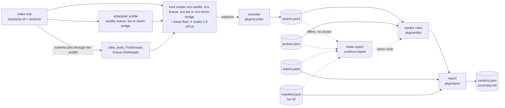

# Architecture

The suite runs scheduler-neutral scenarios against a real kube-scheduler (and, for the kueue profile,
real Kueue; for the kai profile, KAI Scheduler places the pods instead; for the slurm-bridge profile,
Slurm decides each placement and slurm-bridge's scheduler binds the pods) on a cluster whose GPU nodes are
simulated. Placement and timing are real scheduler
decisions; no workload actually runs.

Terms used below:

- **probe**: one capability scenario, one Ginkgo spec in `test/e2e/`.
- **profile**: how one scheduler expresses the suite's jobs (`pkg/scheduler/vanilla`, `pkg/scheduler/kueue`,
  `pkg/scheduler/kai`, `pkg/scheduler/slurmbridge`).
- **claim**: what a scheduler's documentation says about a capability, with a citation, in `claims/`.
- **control**: a probe that repeats a scenario without the mechanism under test (`gang-control`,
  `topology-control`), to show what the scheduler does anyway.
- **evidence window**: the events a probe's verdict reads: those carrying the probe's label, recorded
  no later than the probe's `window_end`.

## Data flow

`make e2e` calls `hack/e2e.sh`, which runs the Ginkgo suite once per profile. For each profile the
suite:

1. creates the kind cluster `scs-<profile>` from the pinned node image, with the `GenericWorkload` and
   `TopologyAwareWorkloadScheduling` feature gates on and `scheduling.k8s.io/v1beta1` served;
2. installs kwok, moves kind's own DaemonSets off the fake nodes, and creates the fleet: nodes `n1` and
   `n2` in `rack-a`, `n3` and `n4` in `rack-b`, 8 `nvidia.com/gpu` each;
3. installs the profile (vanilla: three PriorityClasses; kueue: the Kueue release, its webhook wait, a
   Topology, a ResourceFlavor and two WorkloadPriorityClasses; kai: the KAI chart render without its helm
   hooks, a wait for the operator's Deployments and webhooks, two PriorityClasses and a Topology;
   slurm-bridge: the operator, Slurm and slurm-bridge chart renders with keys generated at install, the
   PodGroup CRD, a Token and a kwok Stage, the fleet nodes registered as Slurm external nodes, a wait
   until Slurm has them idle in both partitions, and two PriorityClasses);
4. measures the host-to-API-server clock offset and starts the recorder;
5. runs the selected probes in a fixed order: gang, gang-control, priority, preemption, fair-share,
   backfill, topology, topology-control;
6. after the last probe: stops the recorder, writes `probes.json` and `claims.yaml`, merges its entry
   into `manifest.json`, writes `verdicts.json` and `summary.md` for the run so far, and checks that the offline rebuild of
   this profile's verdicts equals what the probes computed live;
7. exports the cluster logs and deletes the cluster (unless `KEEP_CLUSTER` says otherwise).

## A probe's lifecycle

| step | what happens | code |
|---|---|---|
| setup | checks that no suite pod is left on the fleet, creates one namespace per tenant (`scs-<probe>-<tenant>`), asks the profile to prepare (kueue: a ClusterQueue and LocalQueue per tenant; kai: a parent Queue for the probe and a leaf Queue per tenant), records each control-plane container's restart count | `startScenario` in `test/e2e/harness_test.go` |
| submit | creates the scenario's jobs through the profile, with the scenario's offsets (for example, fair-share's tenant B 10 s after A) | `submit`, `pause` |
| wait | `mustAwait` waits for the scenario to take shape (fillers running); a timeout there is a harness failure. `await` waits for the outcome being judged; a timeout there is evidence, and the verdict reads it | `mustAwait`, `await` |
| settle | waits 2 s, so the transition that ended the wait reaches the recorder's watches before the window closes | `settle`, `finish` |
| close the window | records `window_end`, flushes the recorder, fails the probe if a watch failed or relisted, or if any control-plane container restarted, since the probe started | `finish` |
| verdict | reads `events.jsonl` back from disk and evaluates the rule, the same call `cmd/scs-report` makes | `finish`, `verdict.Evaluate` |
| cleanup | deletes the tenant namespaces, waits up to 3 minutes for every suite pod to go, then the profile's cleanup, up to 2 minutes (kueue: the ClusterQueues; kai: the Queues; slurm-bridge: a wait until Slurm has no pending or running job of the probe); the whole step has 6 minutes | `cleanup` |

Events recorded after `window_end`, such as the cleanup's deletions, never reach a verdict.

## Package map

| package | role |
|---|---|
| `pkg/apply` | server-side apply of multi-document YAML through client-go |
| `pkg/claims` | loads and validates `claims/<profile>.yaml` |
| `pkg/cluster` | creates and deletes kind clusters, holds the per-profile cluster lock, pins the node image, measures clock offset |
| `pkg/events` | the `events.jsonl` schema (version 1): reader and writer |
| `pkg/fleet` | the fake GPU fleet: four nodes, two racks, its node manifests |
| `pkg/kwok` | installs kwok v0.8.0 from embedded, sha256-pinned manifests |
| `pkg/labels` | label keys the suite puts on everything it creates |
| `pkg/recorder` | watches Pods, Jobs, Events and Kueue Workloads, writes every transition to `events.jsonl` |
| `pkg/report` | `manifest.json`, `verdicts.json` and `summary.md`; shared by the suite and `scs-report` |
| `pkg/scheduler` | the `Profile` interface every scheduler implements |
| `pkg/scheduler/vanilla` | the kube-scheduler 1.37 profile: PriorityClasses, standalone PodGroups |
| `pkg/scheduler/kueue` | the Kueue v0.20.1 profile: embedded release manifest, queues, cohorts, topology |
| `pkg/scheduler/kai` | the KAI Scheduler v0.18.5 profile: embedded chart render, PodGroups, queues, topology |
| `pkg/scheduler/slurmbridge` | the slurm-bridge v1.2.3 profile: embedded chart renders, generated keys, Slurm external nodes and partitions, PodGroups, Slurm job annotations |
| `pkg/verdict` | the verdict rules: pure functions from events and parameters to a verdict |
| `pkg/workload` | a scheduler-neutral job description and the batch/v1 Job it starts from |
| `cmd/scs-report` | rebuilds a run's `verdicts.json` and `summary.md` offline |
| `test/e2e` | the Ginkgo suite: `suite_test.go` (setup, teardown), `harness_test.go` (probe lifecycle), one file per probe |
| `hack` | `e2e.sh` runs the suite per profile; `vm-bootstrap.sh` prepares a Linux VM |

## Design rules

**Events are the single source of truth.** A verdict reads only `events.jsonl` and the probe's
parameters in `probes.json`; it never queries the cluster. The harness reads cluster state only to wait
and to check its own preconditions. Rules use the recorder's `observed_at` clock throughout: one clock, nanosecond
resolution.

**Rebuilds work offline.** Every rule in `pkg/verdict` is a pure function, and the suite and
`cmd/scs-report` call the same `report.Write`. At the end of each profile the suite rebuilds that
profile's verdicts from disk and fails if they differ from the live ones. Float sums are written so
that a run on arm64 and a rebuild on amd64 agree to the last bit (`make lint` checks the compiled code).

**Documented vs observed.** Each capability has a claim per profile in `claims/`, quoted from the
scheduler's documentation with a citation, and the outcome that claim implies under the suite's rule
(`expected`). The run copies the claims file into its results, so a later edit to `claims/` does not
change an old run's rebuild. A disagreement is reported as a finding, not as a failure.

**Controls.** `gang-control` and `topology-control` run on vanilla only, without the gang and the
one-rack constraint respectively. A verdict that its control also reaches has not shown that the
mechanism made the difference. Controls have no claim and are listed separately in `summary.md`.

**One cluster per profile at a time.** Before creating `scs-<profile>`, the suite takes an exclusive
lock on `/tmp/scs-<profile>.lock`. It holds the lock until it deletes the cluster or, when
`KEEP_CLUSTER` keeps the cluster, until the test process exits. A second run of the same profile on this
host fails at once instead of racing. The lock is per profile: it does not stop a vanilla run and a
kueue run from overlapping, so do not start two runs on one host; the clusters would compete for CPU and
disk and skew the timings. Within one `make e2e` the profiles run one after the other. The suite also
refuses to start if a kind cluster of that name exists: it never reuses or deletes a cluster it did not
create in this run. The lock lives in `/tmp`, a fixed path,
because `$TMPDIR` can differ between processes on macOS and every run on the host must find the same lock.

**A broken harness is red, an unexpected verdict is green.** A run is red when the harness could not
produce trustworthy evidence: a scenario that never took shape, a watch error or relist during a
probe, a control-plane restart during a probe, a failed clock check, or a rebuild that disagrees with
the live verdicts. Whatever the verdict says, a clean run is green.
